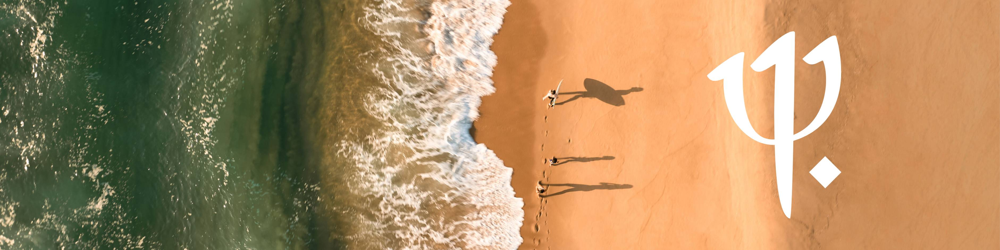

<p align="center">
  
</p>

<p align="center">
  The central knowledge base of the <strong>Club Med AI Guild</strong> —<br/>
  skills, MCP servers, and best practices shared across teams.
</p>

<p align="center">
  <a href="https://github.com/ClubMediterranee/ai-core/stargazers">
    
  </a>
  <a href="https://github.com/ClubMediterranee/ai-core/network/members">
    
  </a>
  <a href="https://github.com/ClubMediterranee/ai-core/commits/main">
    
  </a>
  <a href="https://github.com/ClubMediterranee/ai-core/graphs/contributors">
    
  </a>
  <a href="https://github.com/ClubMediterranee/ai-core/pulls">
    
  </a>
</p>

---

## What's inside

### [Plugins](plugins/README.md) — 4 available

Role-based bundles that install a curated set of skills in one command.

```bash
# Once globally — register the marketplace on your machine
claude plugin marketplace add ClubMediterranee/ai-core

# Per project — install the plugin that matches your stack
claude plugin install clubmed-tracking-data@clubmed --scope project   # GA4 tracking plans / analytics
claude plugin install clubmed-product@clubmed --scope project         # Spec generation / PRD / Product
claude plugin install clubmed-github@clubmed --scope project          # GitHub workflow / PR / MCP
claude plugin install clubmed-qa@clubmed --scope project              # Playwright E2E test generation
```

| Plugin | Stack | Skills included |
|--------|-------|-----------------|
| `clubmed-tracking-data` | GA4 tracking plans · analytics · Figma | 6 skills |
| `clubmed-product` | Spec generation · PRD · User stories | 1 skill |
| `clubmed-github` | GitHub workflow · PR lifecycle · MCP | 10 skills |
| `clubmed-qa` | Playwright · E2E · cross-browser testing | 1 skill |

### [Skills](skills/README.md) — 8 standalone

Standalone slash commands that belong to no plugin, installed one by one. Every other skill ships inside its plugin above.

| Category | Skills |
|----------|--------|
| Accessibility | `a11y-audit` · `a11y-web` |
| Config | `agent-creator` · `skill-creator` |
| Design | `excalidraw` · `trident-icons` · `trident-ui-install` |
| Project Management | `jira-fetch` |

### [MCP Servers](mcps/README.md) — 5 available

Curated MCP servers to connect Claude to external tools.

| Server | Category |
|--------|----------|
| `context7` | Development |
| `figma` | Design |
| `github` | Development |
| `gtm` | Analytics |
| `playwright` | Testing / Automation |
| `trident-icons` | Design — 🚧 in progress |

---

## Contributors

<a href="https://github.com/ClubMediterranee/ai-core/graphs/contributors">
  
</a>

---

<p align="center">
  <sub>Built with care by the <strong>AI Guild · Club Med</strong> &nbsp;·&nbsp; <a href="https://github.com/ClubMediterranee/ai-core/issues/new">Report an issue</a></sub>
</p>
